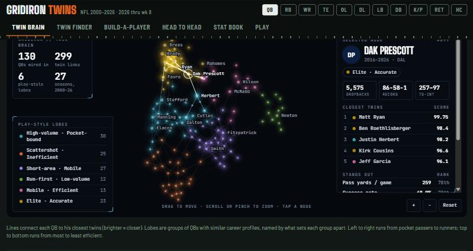

# Gridiron Twins

**Play it: https://isaiahhuus.github.io/gridiron-twins/**



Every NFL player since 2000, graded against the players of his own season, so a 2004 quarterback and a 2025 quarterback are measured fairly. Find any player's statistical twin, build a made-up player and see who he plays like, and compare anyone head to head.

Tabs: QB, RB, WR, TE, OL, DL, LB, DB, kickers and punters, returners, and head coaches.

## Views

- **Twin Brain:** every player as a glowing node, wired to his closest twins. Players who play alike pull together into named lobes. Tap a node to fire its connections.
- **Twin Finder:** pick a player (whole career, one season or a year range) and get every other player ranked by twin score, with a top 5, a twin map and a stat-by-stat comparison.
- **Build-a-Player:** drag sliders to describe a player and see the closest real players update live.
- **Head to Head:** any two players as careers or seasons, with era grades, totals and a season-by-season chart.
- **Stat Book:** every season or career, sortable, raw numbers or era grades.
- **Play:** Name the Twin, Mystery Season, Higher or Lower.

## How the numbers work

1. Stats come from regular-season play-by-play.
2. Each stat is turned into a score against that season's qualified players (scaled down for a season still in progress).
3. A career profile is the playing-time-weighted average of those season scores.
4. Stat weights = how strongly a player's score repeats from one season to the next.
5. Twin score = the share of all player pairs that are farther apart than this pair.

Only real contributors are included (for example, 50+ touches for an RB season or 40+ targets for a WR season). Positions with very different jobs are graded within their spot: tackles, guards and centers; edge and interior linemen; edge and off-ball linebackers; corners and safeties; kickers and punters.

## Data and credits

- Data: [nflverse](https://github.com/nflverse/nflverse-data) (play-by-play from nflfastR, depth charts, snap counts, player info), licensed [CC BY 4.0](https://creativecommons.org/licenses/by/4.0/). Changes made here: plays are summed into player seasons, era grades and twin scores are computed, and missing 2003-2008 targets are rebuilt from the play descriptions. See [NOTICE.md](NOTICE.md).
- Built with [D3](https://d3js.org/) (ISC license) and Google Fonts (SIL Open Font License).
- Inspired by an @essentiallysportsmedia Instagram reel (the twin method) and a @metakaihos TikTok (the brain look).
- A fan project, not affiliated with or endorsed by the NFL or any team.

## Rebuild the stats

Download the nflverse files into `raw/` (play-by-play `pbp/play_by_play_YYYY.csv.gz`, `players.csv`, `depth_charts/`, `snap_counts/`), then:

```bash
python -I pipeline/build_qb.py raw app/qb-data.js
python -I pipeline/build_rb.py raw app/rb-data.js
python -I pipeline/build_rec.py raw app
python -I pipeline/build_ol.py raw app/ol-data.js
python -I pipeline/build_def.py raw app DL LB DB
python -I pipeline/build_st.py raw app/kp-data.js
python -I pipeline/build_ret.py raw app/ret-data.js
python -I pipeline/build_hc.py raw app/hc-data.js
python -I tools/make_site.py
```

`app/index.html` is the whole app. `tools/make_site.py` wraps it into `docs/index.html` and copies the stats files for GitHub Pages. `tools/serve.py` runs a local preview at http://localhost:4870.

Data gap worth knowing: the 2003-2008 play-by-play leaves the intended receiver off incompletions and interceptions, so the builders read the target's name from the play text and match it to that team's player.

---

Code © 2026 Isaiah Huus. The stats files in `docs/` are derived from nflverse data under CC BY 4.0.
